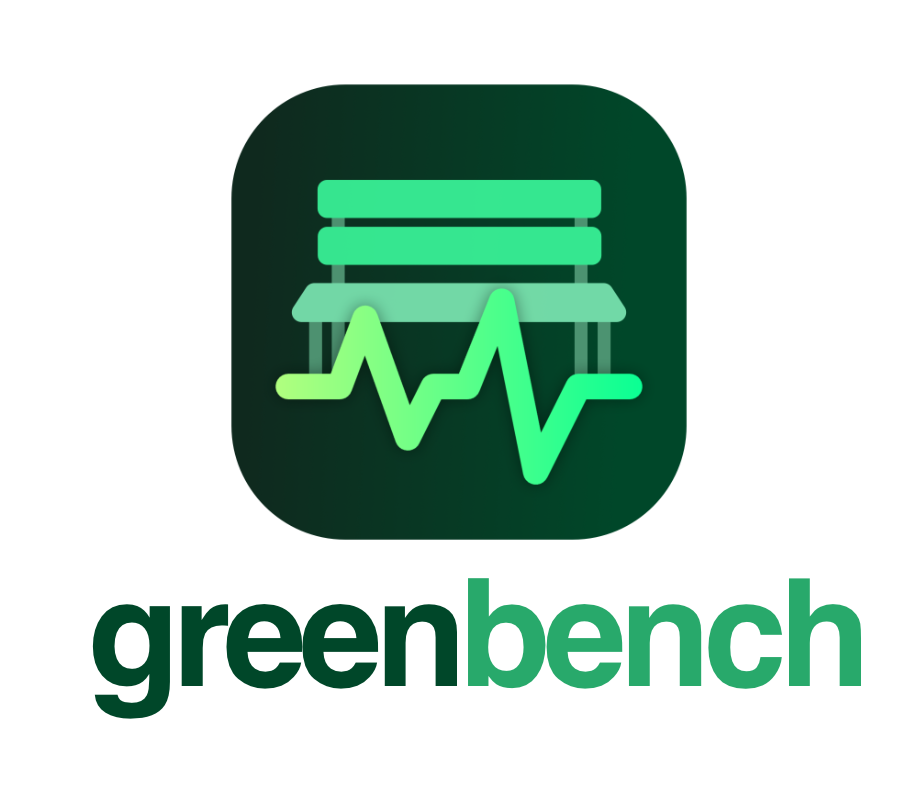

<p align="center">
  
</p>

# GreenBench

### Automated, localized software energy benchmarking framework _designed for developers_

**Does your latest feature branch or software optimization really make your system more energy efficient?** GreenBench measures it, repeats the measurement enough times to tell signal from noise, and gives you a statistically sound answer before your code ever reaches production.

GreenBench is a command-line framework that lets developers run energy benchmarking experiments on their own machine. It runs the same workload command against two copies of your project (a _baseline_ and a _treatment_) and alternates between them in a randomized order. It records the energy used by each run with [EnergiBridge](https://github.com/tdurieux/EnergiBridge), then reports whether the difference is statistically significant and what it means in gCO2e.

GreenBench is meant for **local development machines**. Absolute numbers are only meaningful relative to each other, so the value lies in the _comparison_.

> New to this? Start with the [basic intro](https://github.com/jessicadraper/green-bench/blob/main/docs/getting-started.md).
> Want the details? See the [user guide](https://github.com/jessicadraper/green-bench/blob/main/docs/user-guide.md).

## Why GreenBench?

The electricity consumption of data centers is rising quickly, driven by cloud computing and AI. Every application deployed to that infrastructure contributes to its footprint. Yet developers have few practical ways to see how their own design decisions affect energy use.

- **Cloud carbon dashboards arrive too late.** Cloud providers such as AWS and Azure offer emissions dashboards and reports, but only after the software has been deployed and run. Those emissions have already been spent.
- **They are also too coarse.** Dashboards estimate emissions per service or cluster, not per application, feature branch or design decision. They can't tell you whether the query you just rewrote helped.
- **Hardware power meters** are accurate, but they cost time and money to set up and are rarely available to software teams.
- **Software energy profilers** such as EnergiBridge make measurement accessible from the command line. On their own, though, they measure one run. A single measurement on a busy laptop is dominated by noise, and turning it into a trustworthy comparison takes repeated runs, interleaving, warm-ups, environment resets and statistical testing.
- **Research-grade experiment orchestrators** exist, but they are designed for academic labs rather than day-to-day development.

GreenBench closes this gap by bringing the experimental methodology used in software energy research into the place developers already work: Git branches on a local machine. This is a **"shift left"** approach to green software. Energy becomes something you can test during development, the same way you test correctness or performance, rather than something you discover on a cloud bill.

## Quickstart

```bash
pipx install "green-bench[plots]"     # or: pip install "green-bench[plots]"; drop [plots] if you don't need the charts
green-bench --version
```

You also need [EnergiBridge](https://github.com/tdurieux/EnergiBridge) installed. Then try the built-in example (two versions of an N-Queens solver; no project of your own needed):

```bash
green-bench demo
```

The demo copies the two example programs into `./green-bench-demo/` and **prints the exact `green-bench` command it runs**, so you can reuse it on your own project. With two directories that hold the two versions of your project, that looks like:

```bash
green-bench \
  --name my-experiment \
  --base ./project-v1 \
  --compare ./project-v2 \
  --setup 'true' \
  --cmd 'python workload.py' \
  -n 30
```

Results are written to `green-bench-results/my-experiment/`:

- `data.csv` (one row per run)
- `results.csv` (the statistics)
- two plots
- `output.log`.

## Requirements

- Python 3.10+
- **[EnergiBridge](https://github.com/tdurieux/EnergiBridge)** installed so that `energibridge --version` works in your terminal. It reads hardware energy counters, which usually requires elevated privileges (e.g. running the terminal with `sudo` on macOS/Linux). Follow its README for current installation instructions and supported hardware.
- Two directories containing the versions to compare (for example two `git clone`/`git worktree` checkouts of different branches or commits).
- A workload that is _computationally significant_: it should run for several seconds, not milliseconds, and do the same work every time.

## Before you measure

GreenBench measures system-wide power, so anything else your machine is doing ends up in the numbers. To reduce noise:

- Close other applications and background processes
- Plug into power and disable sleep
- Turn off Wi-Fi/Bluetooth if the workload does not need them
- Run from a plain terminal, not an IDE
- Keep the room temperature and the laptop's position consistent between sessions
- If you can, run your services natively rather than inside Docker Desktop, whose VM adds background CPU load
- Run the workload as a plain script rather than through a test runner, which adds its own overhead

## Options

| Flag                 | Default               | Meaning                                                                             |
| -------------------- | --------------------- | ----------------------------------------------------------------------------------- |
| `--name`             | required              | Name of the experiment (becomes the results folder; letters, digits, `.`, `_`, `-`) |
| `--base`, `-b`       | required              | Directory with the **baseline** version                                             |
| `--compare`, `-c`    | required              | Directory with the **treatment** version                                            |
| `--setup`            | required              | Shell command run before every measurement, _not_ measured (use `true` for none)    |
| `--cmd`              | required              | Shell command to measure                                                            |
| `--iterations`, `-n` | `30`                  | Runs per version (30+ recommended; below 10 results are unreliable)                 |
| `--intensity`        | `475`                 | Grid carbon intensity in gCO2e/kWh                                                  |
| `--output`, `-o`     | `green-bench-results` | Where results are saved                                                             |
| `--seed`             | random                | Seed for the run order (printed at the start so you can reproduce it)               |
| `--cooldown`         | `10`                  | Seconds between setup and measurement                                               |
| `--interval`         | `500`                 | EnergiBridge sampling interval (ms)                                                 |
| `--timeout`          | none                  | Abort any single command after this many seconds                                    |
| `--keep-raw`         | off                   | Keep every run's raw EnergiBridge CSV in `<results>/raw/`                           |
| `--resume`           | off                   | Continue an interrupted experiment of the same name                                 |
| `--overwrite`        | off                   | Replace an existing results folder without asking (otherwise you are prompted)      |
| `--no-plots`         | off                   | Skip chart generation                                                               |

## How it works (short version)

1. **Pre-flight**: checks both directories and that EnergiBridge works.
2. **Warm-up**: runs each version once (discarded) so caches and JITs are warm.
3. **Experiment**: for each of _n_ blocks, runs one baseline and one treatment in **random order within the block** (_block-randomized interleaving_), so slow drifts such as heat build-up cannot favor one version. Before each run: setup command, then a cooldown.
4. **Analysis**: integrates power over time to get Joules, then compares the two groups with a Mann-Whitney U test, reports medians, effect size and a bootstrap confidence interval, and converts the difference to gCO2e.

A technical reference for architecture diagrams, statistics, and limitations is coming soon.

## What it found in practice (a case study)

GreenBench was validated on a real-world web application under active development: a Node.js / PostgreSQL / Redis platform for refurbished spare parts. The test workload was a bulk import that parsed, matched and imported 1,070 inventory rows. Each comparison used 30 runs per version on an Apple M1 MacBook Air.

| Comparison                                                                | Energy change | Significant?        |
| ------------------------------------------------------------------------- | ------------- | ------------------- |
| Control: identical code vs. itself                                        | −2.17%        | No (p = 0.126)      |
| Code level: refactoring long, complex methods                             | −3.22%        | No (p = 0.105)      |
| Logic level: Protobuf instead of JSON between services                    | +1.07%        | No (p = 0.363)      |
| Logic level: bulk database I/O instead of row-by-row queries              | **−63.24%**   | **Yes** (p < 0.001) |
| Architecture: microservices merged into a single-process modular monolith | **+22.46%**   | **Yes** (p < 0.001) |

The control run shows that GreenBench does not report false differences when nothing has changed. The treatments show where energy is actually decided: higher-level design decisions such as data access patterns and architecture, not code cleanliness.

These results belong to one application and one workload, and yours will differ. That is the point of GreenBench: to empower developers like you to measure your own system for real impact!

## Development

```bash
pip install -e ".[dev]"
pytest -m "not integration"    # no energy hardware needed
ruff check src tests
```

See [CONTRIBUTING.md](https://github.com/jessicadraper/green-bench/blob/main/CONTRIBUTING.md) and the [CHANGELOG.md](https://github.com/jessicadraper/green-bench/blob/main/CHANGELOG.md).

## Background and citation

GreenBench was created as part of the MSc thesis _"Evaluating the Environmental Impact of Software Design: An Empirical Analysis using Automated Software Emissions Benchmarking"_ by Jessica Draper (Software Design and Engineering, Hochschule Campus Wien, Vienna, 2026). If you use GreenBench in research, please cite it (see [CITATION.cff](https://github.com/jessicadraper/green-bench/blob/main/CITATION.cff)).

## License

MIT, see [LICENSE](https://github.com/jessicadraper/green-bench/blob/main/LICENSE).
